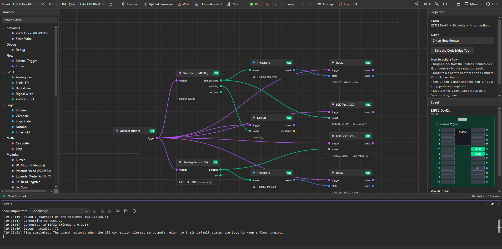

<p align="center">
  
</p>

# CodeBridge

[](https://github.com/Christian9005/CodeBridge/actions/workflows/ci.yml)
[](https://www.nuget.org/packages/CodeBridge.ESP32)
[](https://marketplace.visualstudio.com/)
[](LICENSE)

**Control ESP32 and Arduino boards from .NET: in C#, or with a visual flow editor inside Visual Studio.**
CodeBridge ships a bridge firmware for the board and a .NET SDK that talks to it over USB serial or Wi-Fi, so you write
C# instead of embedded C/C++, and change the logic without reflashing.

<p align="center">
  
</p>

**See what it can do:** [build a smart greenhouse](docs/greenhouse.md) that reads the air and the soil, runs a fan, waters the plants
and shows it all on a display. It runs on the simulator before you buy a single part, and the same file runs on a real ESP32.

- **Local and safe.** No cloud, no account. Wi-Fi needs a pairing token, the mesh signs every frame.
- **Change it live.** The flow runs from your PC: edit, press Run, see it on the board. Export it to C# when you outgrow the blocks.
- **Many boards, many sensors.** ESP32, S3, C3, S2, XIAO, Arduino Uno, Nano and Mega; 65 blocks, plus generic I2C blocks that reach any chip.
- **Fits your stack.** ASP.NET Core, Blazor, MAUI, Windows services, Home Assistant, and an MCP server for AI assistants.

## Two ways to use it

| You are... | Use | Start here |
|---|---|---|
| New to microcontrollers / prefer visual tools | **CodeBridge Visual Studio Tools** (VSIX) | [Getting started](docs/getting-started.md) |
| A .NET developer who wants the SDK directly | **NuGet packages** | [SDK quick start](#sdk-quick-start) |
| Not on Windows, or no Visual Studio | **The browser editor** (`codebridge-web`) | [Web editor](docs/web-editor.md) |
| Curious, with no board yet | **The simulator** | [The greenhouse in 2 minutes](docs/greenhouse.md#1-try-it-with-no-hardware) |

## NuGet packages

| Package | Purpose | Target |
|---|---|---|
| `CodeBridge.Abstractions` | Abstractions (`IBoard`, `ITransport`), wire protocol, exceptions. The assembly and namespace are `CodeBridge.Core`; the NuGet id `CodeBridge.Core` belongs to another project | net8.0 |
| `CodeBridge.Transport` | Serial and TCP/Wi-Fi transports, USB board discovery | net8.0 (Windows for USB discovery) |
| `CodeBridge.ESP32` | ESP32 board + sensor/actuator drivers | net8.0 |
| `CodeBridge.Flow` | Flow document model, validation, runtime | net8.0 |
| `CodeBridge.Designer.WinForms` | WinForms Toolbox controls, designer, firmware flashing (ships the firmware) | net8.0-windows |

```powershell
dotnet add package CodeBridge.ESP32
```

## SDK quick start

Flash the firmware once (see [Getting started](docs/getting-started.md#flash-the-firmware)), then:

```csharp
using CodeBridge.Core;
using CodeBridge.Core.Enums;
using CodeBridge.ESP32;

await using var board = await CodeBridgeBuilder
    .Connect()
    .Serial("COM3", baudRate: 115200)   // or .WiFi("192.168.1.50")
    .ToESP32()
    .BuildAsync();

await board.Gpio.SetPinModeAsync(2, PinMode.Output);
await board.Gpio.DigitalWriteAsync(2, PinValue.High);

int raw = await board.Gpio.AnalogReadAsync(34);   // 12-bit ADC value
Console.WriteLine($"ADC34 = {raw}");
```

More runnable examples are in [`samples/`](samples) (blink, servo, motor/relay, Wi-Fi setup and diagnostics).
See the [API reference](docs/api-reference.md).

## Visual Studio extension

- **`.cbflow` visual flow editor**: drag blocks, wire ports, edit properties; follows the active Visual Studio theme.
  Its toolbar picks the board and port, tests the connection, uploads the firmware and runs the flow on the real board with live
  per-block status, undo/redo, copy/paste, multi-select and live validation. Hover any block for an animated explanation;
  five ready-made [examples](docs/examples.md) are available from *Add > New Item*, and *Tools > CodeBridge Tour*
  walks you from the first blink to using the SDK from a [console app, web API or Windows service](samples).
- **WinForms Toolbox components**: `CodeBridgeFlowControl` and `CodeBridgeBoardComponent` with Smart Tags to pick a COM port,
  detect the board and flash the firmware.
- **One-click firmware flashing for ESP32**: uses `esptool`, downloaded on first use over HTTPS and verified by SHA-256.
  No Python, PlatformIO or Arduino IDE needed. The firmware binaries ship inside `CodeBridge.Designer.WinForms`.
- **Serial monitor and plotter** inside Visual Studio, and **code mode**: create, build and upload C++ firmware with PlatformIO, with errors in the Error List.
- **Export C#**: turn any flow into readable SDK code (a class for your project, or a console `Program.cs`) from the editor toolbar.
- **Project and item templates**: the *CodeBridge WinForms App* template runs `Flows\Blink.cbflow` on the first F5 (on the board it finds, or on the simulator) and runs it again every time you save it. Also a setup window (*Tools > CodeBridge Setup...*) and a starter form command.
- **Automatic USB board detection** for CP210x, CH340/CH9102, FTDI and official Arduino adapters.

## Hardware support

| Board | Status |
|---|---|
| **ESP32 DevKit (esp32dev)** | Supported and tested on hardware: GPIO, ADC, PWM, I2C, SPI, 1-Wire, interrupts, sensors, displays, Wi-Fi, ESP-NOW mesh gateway, one-click firmware |
| **XIAO ESP32-S3** | Its own firmware build (native USB); flashed and used on hardware, including as an ESP-NOW mesh node |
| **ESP32-S3 DevKit**, **ESP32-C3 DevKit**, **ESP32-S2 Mini** | Firmware builds in CI and one-click flashing is wired up; pin maps follow the official pinouts. Not yet verified on hardware: please report what you find |
| **Arduino Uno R3** | Basic: digital/analog I/O, PWM, servo via the bridge sketch. Flashing needs [`arduino-cli`](https://arduino.github.io/arduino-cli/) |
| **Arduino Nano**, **Arduino Mega 2560** | Same sketch (it builds in CI for both); Nano comes in two bootloader flavours (pick "old bootloader" for most clones). Not yet verified on hardware |
| Any board, no hardware | The built-in **simulator** (`.Simulator()`, or *Simulator* in the editor's Port list) runs flows, tests and demos without a cable |
| STM32, PIC | Planned; `ToSTM32()` exists in the builder but there is no driver yet and building throws `NotSupportedException` |

Drivers included for ESP32: DHT11/22, DS18B20, BME280, BH1750, MPU6050, TCS34725, INA219, HC-SR04, PIR, gas sensors,
relays, buzzers, servos, DC/stepper motors, RGB LED, WS2812B NeoPixel, SSD1306 OLED, HD44780 I2C LCD, MQTT, OTA. All of them are
blocks in the flow editor, and [`CodeBridge.IotBindings`](docs/iot-bindings.md) adds 25 more from the .NET IoT drivers (SHT3x/4x, BMP280,
SCD4x CO₂, laser distance, clocks, expanders, displays) plus generic I2C blocks for any chip.

## Use it from your app

| Package | What for |
|---|---|
| `CodeBridge.Hosting` | `services.AddCodeBridge()`: one shared, thread-safe board connection with reconnection and the simulator, for ASP.NET Core, workers and MAUI |
| `DeviceFleet` (in `CodeBridge.Hosting`) | Any number of named boards (USB, Wi-Fi, or boards reached over an [ESP-NOW mesh](docs/mesh.md) through a gateway that keeps its Wi-Fi) behind one object, with discovery, persistence and per-device reconnection |
| `FlowSupervisor` (in `CodeBridge.Flow`) and `FlowHost serve` | A flow that keeps running by itself (Windows service, container, headless PC): it reconnects when the board goes away. See [docs/headless.md](docs/headless.md) |
| `CodeBridge.IotBindings` | The .NET IoT device drivers (`Iot.Device.Bindings`) on a board over its I2C bus, and 25 of them as flow blocks (weather, air quality, light, distance, clocks, a display, I/O expanders) plus three generic blocks (I2C scan, read and write register) for any chip. See [docs/iot-bindings.md](docs/iot-bindings.md). Proof of concept |
| `codebridge-web` (`CodeBridge.WebEditor`) | The flow editor in a browser, served from your own computer: design, validate, save and run a `.cbflow` on Windows, Linux or macOS without Visual Studio. See [docs/web-editor.md](docs/web-editor.md). Proof of concept |
| `CodeBridge.Blazor` | `<BoardStatus/>`, `<PinToggle/>`, `<PwmSlider/>`, `<AnalogGauge/>`, `<SensorChart/>` components for a live dashboard |
| `CodeBridge.Mcp` | An [MCP server](docs/mcp.md) so an AI assistant can read the board manifest, design and test flows on the simulator and export C# (hardware is opt-in and confirmed per action) |
| `CodeBridge.HomeAssistant` | Shows the board in Home Assistant through MQTT discovery (switches, lights, sensors) and finds Home Assistant on your network |

Samples: [`Integration.Blazor`](samples/Integration.Blazor), [`Integration.HomeAssistant`](samples/Integration.HomeAssistant),
[`Integration.Maui`](samples/Integration.Maui) (Android and Windows), plus console, web API and Windows service.

## Documentation

| Guide | |
|---|---|
| [Getting started](docs/getting-started.md) | Install, flash the firmware, first flow, Wi-Fi |
| [Examples](docs/examples.md) | The ready-made flows and samples |
| [Smart greenhouse](docs/greenhouse.md) | A complete project, from the simulator to a greenhouse that runs by itself |
| [.NET IoT drivers on a board](docs/iot-bindings.md) | The I2C blocks, and how to add a chip in twenty lines |
| [A flow that runs by itself](docs/headless.md) | `FlowHost serve` and Windows services |
| [Web editor](docs/web-editor.md) | The flow editor in a browser |
| [Many boards: fleets and the ESP-NOW mesh](docs/mesh.md) | Gateways, nodes and `DeviceFleet` |
| [Home Assistant](docs/home-assistant.md) | The board in Home Assistant through MQTT |
| [AI assistants (MCP)](docs/mcp.md) | Design and test flows with an assistant |
| [API reference](docs/api-reference.md) | The SDK |

## Architecture

```
Editors              Visual Studio (.cbflow editor, WinForms Toolbox) | browser (codebridge-web) | AI assistant (MCP)
Hosts                FlowHost (run, serve) | your app: Hosting, DeviceFleet, Blazor, MAUI, Home Assistant
SDK (NuGet)          Flow -> Core <- Transport <- ESP32 <- IotBindings     (Designer.WinForms ties them together)
Board firmware       esp32-bridge (PlatformIO, USB / Wi-Fi / ESP-NOW mesh) | arduino-uno-bridge
```

## Security

- Downloaded tools (esptool) must use HTTPS and match a pinned SHA-256.
- Firmware flashing runs child processes that are killed (whole tree) on cancel, so serial ports are released.
- See [SECURITY.md](SECURITY.md) to report a vulnerability.

## Building from source

```powershell
./build/pack.ps1 -Vsix      # packs the 5 NuGet packages and builds the VSIX into artifacts/
dotnet test CodeBridge.slnx -c Release
```

Releasing is described in [docs/publishing.md](docs/publishing.md). Contributions are welcome: see [CONTRIBUTING.md](CONTRIBUTING.md)
and the [changelog](CHANGELOG.md).

## License

MIT, see [LICENSE](LICENSE).
